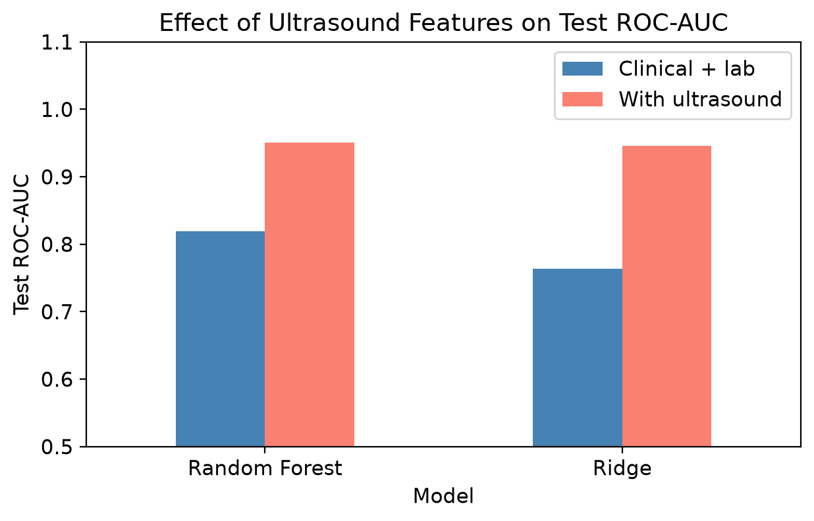

# Pediatric Appendicitis Prediction Using Machine Learning

This project aims to predict whether a pediatric patient is likely to have appendicitis using clinical, laboratory, and ultrasound findings. The system uses a machine learning model trained on patient data to support early risk assessment and clinical decision-making.

## Problem Statement

Appendicitis can be difficult to identify in children because its symptoms may resemble other conditions. This project uses the Regensburg Pediatric Appendicitis dataset to investigate whether patient details, symptoms, laboratory results, and selected ultrasound findings can help classify pediatric patients as having appendicitis or not.

This project examines whether machine-learning models can distinguish pediatric appendicitis cases from non-appendicitis cases, and whether adding ultrasound findings improves predictions.

## Objective

The main objective of this project is to:
- Develop a reliable machine learning model for appendicitis prediction
- Compare models using clinical laboratory features with models that also use selected ultrasound features.
- Evaluate model performance using a held-out test set and cross-validation.
- Present predictions through a streamlit prototype.

## Dataset

The project uses the Regensburg Pediatric Appendicitis dataset from the UCI Machine Learning Repository.

Source:
- UCI Machine Learning Repository
- Dataset ID: 938
- Name: Regensburg Pediatric Appendicitis dataset

Link: https://archive.ics.uci.edu/dataset/938/regensburg+pediatric+appendicitis

The dataset contains pediatric patient records with demographic, clinical, laboratory, and ultrasound-related variables.

## Features Used

The model uses a mix of:
- age and sex
- BMI, height, and weight
- temperature
- CBC (complete blood count) values
- CRP
- urine test findings
- symptoms such as pain, nausea, loss of appetite, and rebound tenderness
- ultrasound findings including appendix diameter, free fluid, and tissue reaction

## Methodology

- The notebook cleans and explores the dataset, removes records without a diagnosis, and excludes features that could leak diagnosis or treatment information. 
- Numerical and categorical features are processed within model pipelines, where missing values are imputed and categorical values are encoded.

- A stratified 80/20 split was used, with 624 records for training and 156 for testing. Five-fold cross-validation was used during model development.
- The project compares logistic regression and a tuned Random Forest, using clinical and laboratory features, then repeats the comparison with selected ultrasound features.

## Model Evaluation

The model is evaluated using relevant classification metrics such as:
- accuracy
- precision
- recall
- F1-score
- ROC-AUC

The project also compares prediction performance across different feature sets, including:
- clinical and lab-only model
- clinical, lab, and ultrasound model

## Application

The project includes a Streamlit web application that allows a user to:
- enter patient details manually
- upload report files
- auto-fill values from uploaded medical reports
- predict appendicitis risk
- view the probability of appendicitis

## Project Structure

- app.py : Streamlit application
- models/ : saved trained machine learning models
- data/ : dataset files
- results/ : generated plots and visual outputs
- README.md : project overview
- requirements.txt : Python dependencies

## Setup

1. Clone the repository
2. Create a virtual environment
3. Install dependencies:
   ```bash
   pip install -r requirements.txt
4. Run the app:
    ```bash
   streamlit run app.py

## Results



- On the held-out test set, the tuned Random Forest using clinical and laboratory features achieved 0.712 accuracy, 0.819 ROC-AUC, and 0.860 recall for appendicitis. 
- With the selected ultrasound features added, it achieved 0.872 accuracy, 0.951 ROC-AUC, and 0.946 appendicitis recall.

These are results from one test split of the dataset. The increase with ultrasound features is promising for this split, but requires validation on independent data before drawing conclusions about performance in other clinical settings.

Note: Insert final metrics and evaluation figures here after the model is finalized.

## Limitations
- The dataset comes from a single source and has a limited number of records.
- The model has not yet been tested on data from other hospitals, so its performance may differ across different patient groups and clinical settings.
- Missing values particularly in ultrasound findings, some ultrasound features having more than 70% of missing values. Although missing values are handled during preprocessing, the actual clinical information cannot always be recovered.
- The project focuses on model performance, but further testing is needed to check prediction reliability and suitable thresholds.